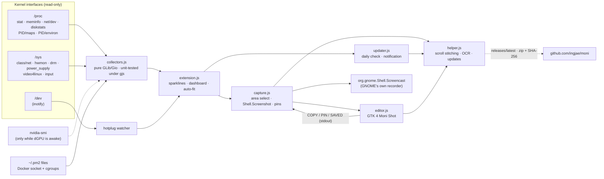

<div align="center">

**English** · [한국어](README.md)

# Moni

**The top-bar system monitor for people who ship robots.**

CPU · RAM · GPU · network · disk · IP, plus ROS 2 processes, rosbag disk ETA, CAN bus, PM2 apps, Docker containers and sensor hotplug.
Shottr-style screenshots with scrolling capture and OCR, screen recording and a clipboard history. All of it lives in the GNOME panel.

[](#compatibility)
[](#compatibility)
[](#-robotics-mode)
[](#how-it-works)
[](LICENSE)


<sub>Settings → General → Style: <b>Color</b> (Apple system colors, top) or <b>Monochrome</b> (grays only, bottom).</sub>

[GitHub](https://github.com/ingjae/moni) · [Highlights](#-highlights) · [Features](#features) · [Install](#install) · [How it works](#how-it-works) · [Configuration](#configuration)

</div>

---

## ✨ Highlights

<table>
<tr>
<td width="50%" valign="top">

### 🛰️ Sees ROS 2 without joining it
Moni lists every ROS 2 process with its CPU, memory, `ROS_DOMAIN_ID`, distro and RMW, and **it is not
a ROS node itself**. It spots `librcl.so` in each process's memory map, so it never sends DDS discovery
traffic and never shows up in `ros2 node list`. Two domains active at once? You get a ⚠.

</td>
<td width="50%" valign="top">

### 💾 Warns before rosbag fills the disk
`● BAG 14m` means *the disk is full in 14 minutes* at the current write rate. The badge turns red under
10 minutes. The rate is measured from the bag directory actually growing on disk, so it doesn't lag
behind the page cache.

</td>
</tr>
<tr>
<td valign="top">

### 🔌 Tells you the LiDAR just dropped off USB
`ttyUSB*`, `ttyACM*`, cameras and gamepads are watched with inotify, so this costs nothing until
something changes. When a device is unplugged you get a notification naming it by its
`/dev/serial/by-id` name.

</td>
<td valign="top">

### 🚌 CAN bus at a glance
`CAN 1.2k` shows live frames/s on `can*` and `vcan*`. The badge turns red when a controller loses
carrier (bus-off). An idle bus stays out of your way and only appears in the dropdown.

</td>
</tr>
<tr>
<td valign="top">

### 📸 Shottr-style capture on Linux
<kbd>Super</kbd>+<kbd>Shift</kbd>+<kbd>S</kbd>: drag an area, a window, the last area or a **scrolling page**,
with a pixel loupe. The editor has 15 tools, from arrows and a freehand pen to blur, smart erase,
spotlight, a **pixel ruler** and crop, plus gradient backdrops. Everything stays movable. Optional OCR
copies text and opens QR links. Copy, save or **pin** the result above all your windows.

</td>
<td valign="top">

### 🎥 Screen recording without a portal prompt
<kbd>Super</kbd>+<kbd>Shift</kbd>+<kbd>D</kbd> records an area or the whole screen through GNOME's own
screencast service, so it works on Wayland with no permission dialog. A red `● REC 0:42` timer stays
in the panel until you press the shortcut again.

</td>
</tr>
<tr>
<td valign="top">

### 🧭 Never covers the clock
On a crowded panel, Moni measures the free space up to the clock and hides the least important chips
first. Alerts like recording, rosbag, ROS, CAN, PM2 and Docker are the last to go. Anything hidden is
still in the dropdown.

</td>
<td valign="top">

### 🪶 Light enough to forget about
One GJS extension that reads `/proc` and `/sys`: no Python, no daemon, no `ros2` / `pm2` / `docker` CLI polling. A
sampling tick takes **0.35 ms**, about 0.1 % of one core in total. A sleeping laptop dGPU shows `zZ`
and is **not woken up** just to be measured.

</td>
</tr>
<tr>
<td valign="top">

### 📋 Clipboard history that pastes for you
<kbd>Super</kbd>+<kbd>Shift</kbd>+<kbd>V</kbd>: type to search, then Enter or click, and the item is
**pasted straight into the window you were in**. Terminals get <kbd>Ctrl</kbd>+<kbd>Shift</kbd>+<kbd>V</kbd>
automatically. ★ keeps the `export ROS_DOMAIN_ID=…` you type ten times a day. Password-manager
copies are never recorded.

</td>
<td valign="top">

### 💼 Take your setup with you
Settings → Backup exports every toggle, shortcut and ★ favorite to one readable JSON file. Import it
on the robot PC and you're done. Unknown or mistyped values are skipped, never coerced.

</td>
</tr>
<tr>
<td valign="top">

### 🐳 PM2 and Docker, crash-aware
`PM2 3/4` and `DOCKER 6` count what is up. A crash loop, an errored app, a restarting or unhealthy
container turns the badge red and sends a notification. Read from `~/.pm2`, `/proc`, the Docker socket
and cgroups, so neither CLI is ever spawned.

</td>
<td valign="top">

### 🎨 Color or monochrome
Rounded, quiet, Control Center-style tiles. **Color** uses Apple's system palette; **Monochrome** turns
every graph, badge and dot gray, and alerts invert to white instead of red. Switch live in Settings.

</td>
</tr>
</table>

<p align="center">
  
  &nbsp;&nbsp;
  
</p>
<p align="center"><sub>Real captures on Ubuntu 24.04 / GNOME 46. Left: the dropdown, scrolled to the robotics tiles (capture actions stay on top). Right: the Moni Shot editor. IPs, paths and internal container names are blurred.</sub></p>

## Features

### Core

| | Top bar | Dropdown |
|---|---|---|
| **CPU** | sparkline + % | history graph, **per-core heat bars**, package temperature |
| **Memory** | sparkline + % | used / total, swap |
| **GPU** | sparkline + % | NVIDIA · AMD · **Jetson**: util, VRAM, temp, power. Sleeping dGPU → `zZ`, never woken |
| **Network** | ↓/↑ graph + rates | throughput, probe-host latency (TCP connect), Wi-Fi signal |
| **IP** | default-route address | every interface (Ethernet, Wi-Fi, Tailscale, …). **Click to copy** |
| **Storage** | root usage % | read/write graph, every real mount with free space |
| **Battery** | — | %, charging state, watts (laptops only) |

### 🤖 Robotics mode

Every feature can be switched off. Each badge **only appears when there is something to show**, so
the panel stays clean when no robot is running.

| Badge | Appears when | Dropdown |
|---|---|---|
| `ROS 7` | ROS 2 processes are running | process table (node / launch / bag / container / CLI) with CPU and RSS, domain, distro, RMW, ⚠ on mixed domains |
| `● BAG 14m` | `ros2 bag record` is running | output dir, write rate, size written, free space, **time until disk full** |
| `CAN 1.2k` | a CAN bus has traffic or errors | per-interface state, rx/tx frames/s, errors, virtual/physical |
| `PM2 2/3` | the PM2 daemon in `~/.pm2` has apps | online/stopped/errored, CPU, memory, restarts, uptime, last exit code. Turns red on an errored app or a crash loop (3+ crashes in 5 min) and notifies you. Read from `~/.pm2` files and `/proc`, never by polling the `pm2` CLI |
| `DOCKER 3` | containers are running | running/exited containers with CPU, memory and status. Turns red while one is unhealthy, restarting or crash-looping (3+ restarts in 5 min); notifies on a non-zero exit, a restart or a failing health check. One request to the Docker Engine socket every 3 s plus the containers' cgroup files — no `docker` CLI |
| — | a sensor is plugged / unplugged | serial devices by `/dev/serial/by-id` name, cameras, gamepads + notifications |

### 📸 Capture

| Shortcut | Action |
|---|---|
| <kbd>Super</kbd>+<kbd>Shift</kbd>+<kbd>S</kbd> | Screenshot: drag an area (click = whole monitor, Esc = cancel) → **Moni Shot** editor |
| …then <kbd>Space</kbd> | Window mode: click the window to capture |
| …then <kbd>Enter</kbd> | Capture the same area as last time |
| …then <kbd>S</kbd> | **Scrolling capture**: drag over the part that scrolls; Moni scrolls it and stitches one tall image (sticky headers kept once) |
| …then <kbd>T</kbd> | Copy text: drag over text → OCR → clipboard (needs the OCR option) |
| …then <kbd>3</kbd> / <kbd>5</kbd> | Timer: capture the screen after 3 or 5 s |
| <kbd>Super</kbd>+<kbd>Shift</kbd>+<kbd>D</kbd> | Start / stop screen recording → `~/Videos/Screencasts/Moni_<time>.webm` |

Both are also at the top of the dropdown and can be rebound in Settings. They default to <kbd>Super</kbd>,
not <kbd>Ctrl</kbd>, so they don't steal *Save As* from your editor, browser or RViz. GNOME's own
<kbd>Print</kbd> tool is left untouched.

**Moni Shot editor keys**

| Key | Tool | | Key | Tool |
|---|---|---|---|---|
| <kbd>V</kbd> | Select and move: drag, resize by the handles, <kbd>Del</kbd> deletes, arrows nudge | | <kbd>B</kbd> | Pixelate |
| <kbd>A</kbd> | Arrow | | <kbd>G</kbd> | Blur |
| <kbd>L</kbd> | Line | | <kbd>E</kbd> | Smart erase (fills with the surrounding color) |
| <kbd>R</kbd> | Rectangle | | <kbd>S</kbd> | Spotlight (dims everything else) |
| <kbd>O</kbd> | Oval | | <kbd>M</kbd> | Ruler (px, dx × dy) |
| <kbd>P</kbd> | Pen (freehand) | | <kbd>I</kbd> | Color picker (copies hex) |
| <kbd>H</kbd> | Highlighter | | <kbd>C</kbd> | Crop |
| <kbd>T</kbd> | Text (double-click to edit) | | <kbd>N</kbd> | Numbered steps |

| Key | Action | | Key | Action |
|---|---|---|---|---|
| <kbd>1</kbd>–<kbd>8</kbd> | Color | | <kbd>Ctrl</kbd>+<kbd>C</kbd> | Copy (stays on the clipboard after the editor closes) |
| <kbd>[</kbd> <kbd>]</kbd> | Line width | | <kbd>Ctrl</kbd>+<kbd>S</kbd> | Save → `~/Pictures/Screenshots/Moni_<time>.png` |
| <kbd>F</kbd> | Filled shapes / text bubble | | <kbd>Ctrl</kbd>+<kbd>P</kbd> | **Pin** above all windows: drag to move, scroll to zoom, right-click to close |
| <kbd>Shift</kbd>+drag | 45° lines, squares and circles | | <kbd>Ctrl</kbd>+<kbd>Z</kbd> / <kbd>Ctrl</kbd>+<kbd>Shift</kbd>+<kbd>Z</kbd> | Undo / redo |
| <kbd>Ctrl</kbd>+scroll | Zoom (<kbd>Ctrl</kbd>+<kbd>0</kbd> fit, <kbd>Ctrl</kbd>+<kbd>1</kbd> 100 %) | | <kbd>Space</kbd>+drag | Pan |
| <kbd>Esc</kbd> | Deselect, then close | | | |

Color, width and fill also restyle the selected annotation. The bottom bar shows the cursor position
in image pixels and the color under it, and holds the backdrop (gradient, rounded corners, shadow),
OCR, pin and save buttons.

**OCR and QR codes** are off by default. Turn on *Settings → Screenshot & recording → Text recognition*
and Moni installs `tesseract-ocr` (English + Korean) and `zbar-tools` through apt, behind your desktop's
password prompt. Then <kbd>T</kbd> in the selector copies text, the editor gets an OCR button, and a
captured QR code shows up as a bar with *Open* and *Copy*. Recognition runs locally.

### 📋 Clipboard history

| | |
|---|---|
| Open | <kbd>Super</kbd>+<kbd>Shift</kbd>+<kbd>V</kbd> or the 📋 panel icon (<kbd>Super</kbd>+<kbd>V</kbd> stays GNOME's notification list) |
| Find | just type: the list filters as you go |
| Paste | <kbd>Enter</kbd> (first match) or click. Moni restores the text to the clipboard and sends <kbd>Ctrl</kbd>+<kbd>V</kbd> (<kbd>Ctrl</kbd>+<kbd>Shift</kbd>+<kbd>V</kbd> in terminals) to the window you came from |
| Keep | ★ pins an item to the top; favorites are saved, recent items live in memory until logout |
| Privacy | copies flagged by password managers (`x-kde-passwordManagerHint`) are skipped; text only, up to 100 KB per item |

Turn off *Paste on pick* in Settings if you'd rather have the item copied back without auto-pasting.

## Install

```bash
git clone https://github.com/ingjae/moni.git && cd moni
make install                 # picks the GNOME 42–44 or 45+ build automatically
```

Restart GNOME Shell (**X11:** <kbd>Alt</kbd>+<kbd>F2</kbd> → `r` · **Wayland:** log out and back in), then:

```bash
gnome-extensions enable moni@ingjae.github.io
```

Prefer a zip? Grab one from [Releases](https://github.com/ingjae/moni/releases):

```bash
gnome-extensions install --force moni@ingjae.github.io.gnome45-48.v0.0.9.zip   # Ubuntu 24.04
gnome-extensions install --force moni@ingjae.github.io.gnome42-44.v0.0.9.zip   # Ubuntu 22.04
```

### Updating

**Which version do I have?** Settings → About → *Version*, or:

```bash
gnome-extensions info moni@ingjae.github.io | grep Version
```

**Automatic (v0.0.7 and later).** Once a day Moni asks GitHub for the latest release. A notification
offers **Update**, and the dropdown shows *Update to Moni x.y.z* until it is applied. Moni downloads the
zip for your GNOME version, checks it against the SHA-256 digest GitHub publishes and installs it.
Settings → Updates turns the daily check off or installs releases without asking.

**Check right now (v0.0.9 and later).** Settings → Updates → **Check now**. If a release is waiting, the
button turns into **Update**.

**Manually** (v0.0.6 or older, or with update checks off), from a clone:

```bash
cd moni && git pull && make install
```

or with a zip from [Releases](https://github.com/ingjae/moni/releases). Compare its SHA-256 with the
digest shown next to the file on the release page first:

```bash
sha256sum moni@ingjae.github.io.gnome45-48.v0.0.9.zip
gnome-extensions install --force moni@ingjae.github.io.gnome45-48.v0.0.9.zip
```

Every update takes effect after a shell restart: **X11:** <kbd>Alt</kbd>+<kbd>F2</kbd> → `r` (the
*Restart now* button in the notification does the same, and windows stay open) · **Wayland:** log out
and back in.

Build requirements: `python3` and `glib-compile-schemas`. Runtime: only what Ubuntu ships with GNOME
(`gjs`, GTK 4, libadwaita). `nvidia-smi` is used if present. The optional OCR / QR feature adds
`tesseract-ocr` and `zbar-tools`, installed from Settings when you turn it on.

## How it works



**ROS radar.** A process counts as a ROS 2 participant when its environment has `ROS_DISTRO` **and**
`librcl.so` is mapped in `/proc/<pid>/maps`. That covers rclcpp, rclpy and rclrs. Results are cached
per PID, so a warm scan only re-reads `/proc/<pid>/stat` for ROS processes. A young process without
`librcl` yet gets 20 s to finish importing rclpy before it is ruled out.

**Capture.** The area selector and pixel grab run inside the shell. The editor is a separate GTK 4
process. Things that must outlive it, like the clipboard and pinned images, are handed back to the
shell over stdout. That is why a copy survives closing the editor. Recording goes through GNOME's own
screencast service, which only accepts calls from the shell's bus connection, and that is exactly
where an extension runs. Scrolling capture drives a virtual mouse wheel from the shell, grabs a frame
per step and leaves the row matching and stitching to `helper.js` in its own process, so the
compositor never stalls.

**Performance**, measured on an i7-14700T (28 threads) with `make test`:

| Work | Cost | How often |
|---|---|---|
| Core tick (CPU, mem, net, disk I/O, CAN, temp) | **0.35 ms** | every 1.5 s |
| ROS radar scan (warm, ~500 processes) | **2.5 ms** | every 3 s |
| ROS radar first scan (cold) | 33 ms | once |
| PM2 scan (`~/.pm2` + `/proc`) | ~1 ms | every 3 s |
| Docker poll (socket + cgroups) | ~11–15 ms, async | every 3 s |
| `ip`, latency probe | async subprocess / socket | every 10 s |

The dropdown is only computed while it is open.

## Configuration

Open **Settings** at the bottom of the dropdown, or run `gnome-extensions prefs moni@ingjae.github.io`.
Everything lives in `org.gnome.shell.extensions.moni`, so you can script it:

```bash
gsettings --schemadir ~/.local/share/gnome-shell/extensions/moni@ingjae.github.io/schemas \
  set org.gnome.shell.extensions.moni show-ip false
```

| Key | Default | |
|---|---|---|
| `update-interval` | `1500` | ms between samples |
| `panel-position` | `right` | `left` / `center` / `right` |
| `style` | `color` | `color` (Apple system colors) / `mono` (grays only; alerts invert instead of turning red) |
| `graph-width` | `28` | px per panel sparkline |
| `show-text` | `true` | numbers next to graphs |
| `show-cpu` `show-ram` `show-gpu` `show-net` `show-disk` `show-ip` | `true` | panel chips |
| `show-ros` `show-rosbag` `show-can` `show-devices` | `true` | robotics mode |
| `notify-devices` | `true` | plug / unplug notifications |
| `show-pm2` / `notify-pm2` | `true` / `true` | PM2 badge + card / crash and errored notifications |
| `show-docker` / `notify-docker` | `true` / `true` | Docker badge + card / exit, restart and unhealthy notifications |
| `internet-probe` / `probe-host` | `true` / `1.1.1.1` | TCP-443 latency check |
| `screenshot-shortcut` / `record-shortcut` | `<Super><Shift>s` / `<Super><Shift>d` | capture shortcuts (empty = off) |
| `record-cursor` | `true` | show the pointer in recordings |
| `ocr` | `false` | OCR and QR codes (turning it on in Settings installs tesseract and zbar) |
| `update-check` / `update-auto` | `true` / `false` | daily release check / install without asking |
| `show-clipboard` / `clipboard-shortcut` | `true` / `<Super><Shift>v` | clipboard history icon + shortcut |
| `clipboard-paste` | `true` | paste into the focused window on pick |
| `clipboard-size` | `50` | recent items kept (memory only) |
| `clipboard-favorites` | `[]` | ★ items |

**Backup.** Settings → Backup → *Export…* writes all of the above to `moni-settings.json`; *Import…* applies it
(keys are type-checked; unknown ones are skipped). From a shell, `dconf dump /org/gnome/shell/extensions/moni/`
works too.

When the panel is crowded, chips are hidden in this order, last one first:
`REC (screen) → BAG → ROS → CAN → PM2 → DOCKER → CPU → RAM → NET → GPU → DISK → IP`.

## Compatibility

| | GNOME | Build | Status |
|---|---|---|---|
| Ubuntu 24.04 | 46 | `esm` (45–48) | ✅ tested (X11 session, nested Wayland shell) |
| Ubuntu 22.04 | 42 | `legacy` (42–44) | 🟡 generated from the same source; `make test` checks collectors and syntax, not yet run on a real 42 session |
| Jetson (L4T, 22.04) | 42 | `legacy` | 🟡 GPU load path supported, untested on hardware |

ROS 2 detection is distro-agnostic. It has been tested with Jazzy.

One source tree, two outputs: `tools/build.py` rewrites the ES-module source into GNOME 42's `imports.*`
form, so the two builds can't drift apart.

## Known limitations

- Processes owned by **another user or root** (e.g. ROS nodes in a root Docker container) can't be
  inspected without privileges, so the radar can't see them.
- **Intel iGPU** utilisation isn't shown, because it needs perf counters / root.
- CAN **bus-off** is inferred from carrier loss. The exact controller state needs netlink.
- A **component container** is listed once, not once per node it hosts.
- PM2 is read from `~/.pm2` of the logged-in user. A PM2 running as root or with a custom `PM2_HOME` isn't seen.
  Restart counts come from `pm2.log`, so they cover what is still in that log.
- Docker needs read access to `/run/docker.sock` (the `docker` group) or a rootless socket in `$XDG_RUNTIME_DIR`.
  Restart counts start when Moni starts. Podman isn't supported.
- The ruler measures what you drag. It doesn't snap to edges the way Shottr does.
- Scrolling capture scrolls with mouse-wheel steps and matches rows exactly. Pages that animate,
  lazy-load or scroll horizontally may stitch short; it stops after 40 frames.
- OCR quality is tesseract's: clean UI text reads well, small or stylised text less so.
- An update replaces the files on disk; the running shell keeps the old code until it restarts.
  The X11 restart and the GNOME 42 (libsoup 2.4) download path haven't been run yet.
- Clipboard history is **text only** for now; images copied from Moni Shot or other apps aren't listed.

## Development

```text
src/
  collectors.js   all data collection — GLib/Gio only, testable under plain gjs
  extension.js    panel chips, dashboard, auto-fit, keybindings
  capture.js      area selection, capture, pins, recording
  clipboard.js    clipboard history, favorites, paste-on-pick
  editor.js       Moni Shot annotation editor (GTK 4, separate process)
  updater.js      daily release check, update notification, restart
  helper.js       scroll stitching, OCR, release download + SHA-256 check (separate process, also imported by the editor)
  prefs.js        libadwaita 1.1-compatible settings window
tools/build.py    → build/esm, build/legacy, dist/*.zip
tests/            collector smoke tests, settings backup round trip, UI regressions
```

```bash
make test      # collector, scroll-stitch, update-rule, settings-backup and UI-regression tests + legacy build load/syntax check
make test-ui   # GTK editor rendering regression tests (requires a graphical session)
make nested    # throwaway GNOME Shell in a window with Moni loaded
make logs      # follow gnome-shell logs filtered for moni
```

## Roadmap

- [ ] Per-topic Hz for a pinned set of topics (passive DDS reader, opt-in)
- [ ] `chrony` clock-offset badge for multi-machine setups
- [ ] Per-process GPU usage in the ROS table
- [ ] Ruler edge-snapping and scrolling capture in Moni Shot
- [ ] Verify on GNOME 42 hardware and publish to extensions.gnome.org

## Prior art & thanks

[Vitals], [TopHat], [system-monitor-next] and [Astra Monitor] showed how good a GNOME panel monitor can be.
[Shottr] set the bar for what a screenshot tool should feel like.

## Feedback

Found a bug, have a question or an idea? Please open an issue:
**[github.com/ingjae/moni/issues](https://github.com/ingjae/moni/issues)**. You can also get there from
Settings → About → *Report an issue*. Including your Ubuntu/GNOME version and `make logs` output helps.

## License

[MIT](LICENSE)

[Vitals]: https://github.com/corecoding/Vitals
[TopHat]: https://github.com/fflewddur/tophat
[system-monitor-next]: https://github.com/mgalgs/gnome-shell-system-monitor-next-applet
[Astra Monitor]: https://github.com/AstraExt/astra-monitor
[Shottr]: https://shottr.cc
