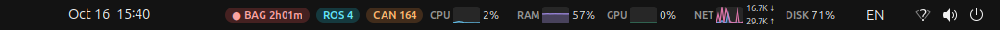
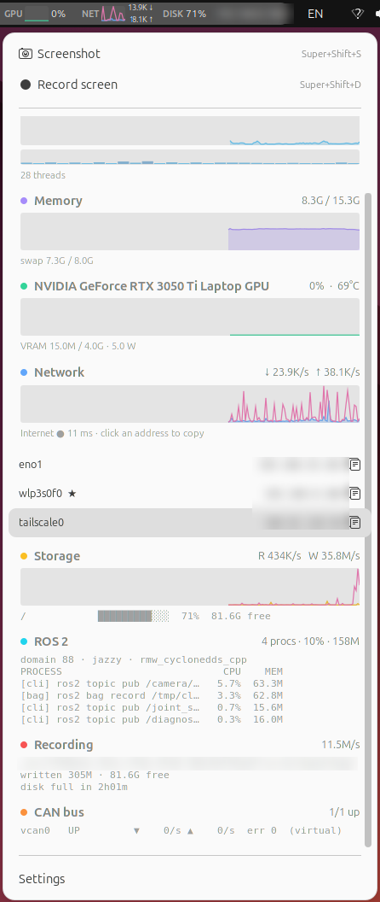
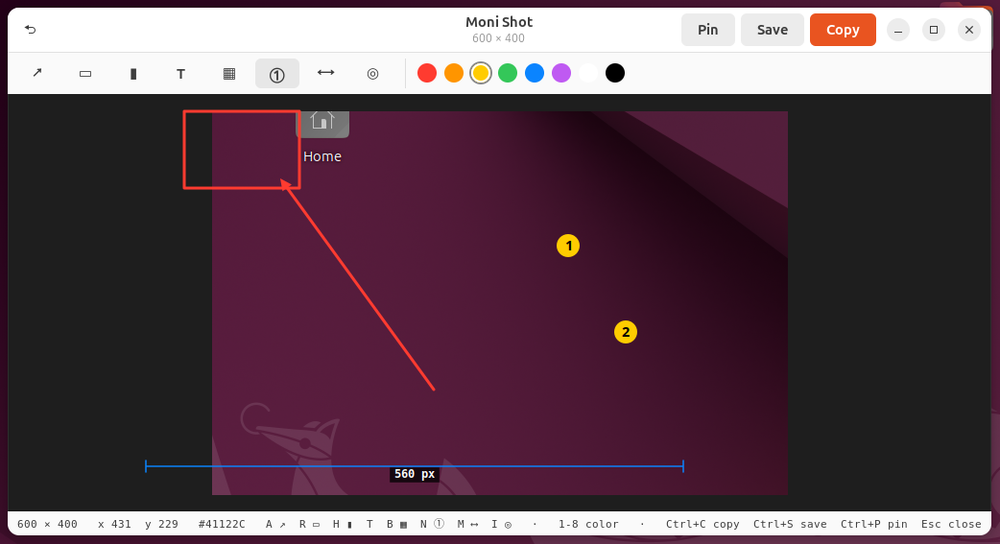
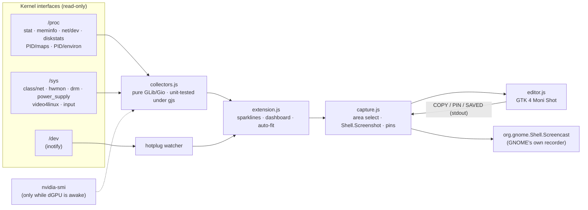

<div align="center">

# Moni

**The top-bar system monitor for people who ship robots.**

CPU · RAM · GPU · network · disk · IP, plus ROS 2 processes, rosbag disk ETA, CAN bus, sensor hotplug
and Shottr-style screenshots & screen recording. All of it lives in the GNOME panel.

[](#compatibility)
[](#compatibility)
[](#-robotics-mode)
[](#how-it-works)
[](LICENSE)



[Highlights](#-highlights) · [Features](#features) · [Install](#install) · [How it works](#how-it-works) · [Configuration](#configuration)

</div>

---

## ✨ Highlights

<table>
<tr>
<td width="50%" valign="top">

### 🛰️ Sees ROS 2 without joining it
Moni lists every ROS 2 process with its CPU, memory, `ROS_DOMAIN_ID`, distro and RMW, and **it is not
a ROS node itself**. It spots `librcl.so` in each process's memory map, so it never sends DDS discovery
traffic and never shows up in `ros2 node list`. Two domains active at once? You get a ⚠.

</td>
<td width="50%" valign="top">

### 💾 Warns before rosbag fills the disk
`● BAG 14m` means *the disk is full in 14 minutes* at the current write rate. The badge turns red under
10 minutes. The rate is measured from the bag directory actually growing on disk, so it doesn't lag
behind the page cache.

</td>
</tr>
<tr>
<td valign="top">

### 🔌 Tells you the LiDAR just dropped off USB
`ttyUSB*`, `ttyACM*`, cameras and gamepads are watched with inotify, so this costs nothing until
something changes. When a device is unplugged you get a notification naming it by its
`/dev/serial/by-id` name.

</td>
<td valign="top">

### 🚌 CAN bus at a glance
`CAN 1.2k` shows live frames/s on `can*` and `vcan*`. The badge turns red when a controller loses
carrier (bus-off). An idle bus stays out of your way and only appears in the dropdown.

</td>
</tr>
<tr>
<td valign="top">

### 📸 Shottr-style capture on Linux
<kbd>Super</kbd>+<kbd>Shift</kbd>+<kbd>S</kbd>: drag an area and an editor opens with arrows, boxes,
highlighter, text, pixelate, numbered steps, a **pixel ruler** and a color picker. Copy it, save it,
or **pin** it above all your windows as a floating reference.

</td>
<td valign="top">

### 🎥 Screen recording without a portal prompt
<kbd>Super</kbd>+<kbd>Shift</kbd>+<kbd>D</kbd> records an area or the whole screen through GNOME's own
screencast service, so it works on Wayland with no permission dialog. A red `● REC 0:42` timer stays
in the panel until you press the shortcut again.

</td>
</tr>
<tr>
<td valign="top">

### 🧭 Never covers the clock
On a crowded panel, Moni measures the free space up to the clock and hides the least important chips
first. Alerts like recording, rosbag, ROS and CAN are the last to go. Anything hidden is still in the
dropdown.

</td>
<td valign="top">

### 🪶 Light enough to forget about
One GJS extension that reads `/proc` and `/sys`: no Python, no daemon, no `ros2` CLI polling. A
sampling tick takes **0.35 ms**, about 0.1 % of one core in total. A sleeping laptop dGPU shows `zZ`
and is **not woken up** just to be measured.

</td>
</tr>
</table>

<p align="center">
  
  &nbsp;&nbsp;
  
</p>
<p align="center"><sub>Real captures on Ubuntu 24.04 / GNOME 46. Left: the dropdown (it scrolls; capture actions stay on top). Right: the Moni Shot editor. Hostname, IPs and paths are blurred.</sub></p>

## Features

### Core

| | Top bar | Dropdown |
|---|---|---|
| **CPU** | sparkline + % | history graph, **per-core heat bars**, package temperature |
| **Memory** | sparkline + % | used / total, swap |
| **GPU** | sparkline + % | NVIDIA · AMD · **Jetson**: util, VRAM, temp, power. Sleeping dGPU → `zZ`, never woken |
| **Network** | ↓/↑ graph + rates | throughput, internet latency (TCP probe), Wi-Fi signal |
| **IP** | default-route address | every interface (Ethernet, Wi-Fi, Tailscale, …). **Click to copy** |
| **Storage** | root usage % | read/write graph, every real mount with free space |
| **Battery** | — | %, charging state, watts (laptops only) |

### 🤖 Robotics mode

Every feature can be switched off. Each badge **only appears when there is something to show**, so
the panel stays clean when no robot is running.

| Badge | Appears when | Dropdown |
|---|---|---|
| `ROS 7` | ROS 2 processes are running | process table (node / launch / bag / container / CLI) with CPU and RSS, domain, distro, RMW, ⚠ on mixed domains |
| `● BAG 14m` | `ros2 bag record` is running | output dir, write rate, size written, free space, **time until disk full** |
| `CAN 1.2k` | a CAN bus has traffic or errors | per-interface state, rx/tx frames/s, errors, virtual/physical |
| — | a sensor is plugged / unplugged | serial devices by `/dev/serial/by-id` name, cameras, gamepads + notifications |

### 📸 Capture

| Shortcut | Action |
|---|---|
| <kbd>Super</kbd>+<kbd>Shift</kbd>+<kbd>S</kbd> | Screenshot: drag an area (click = whole monitor, Esc = cancel) → **Moni Shot** editor |
| <kbd>Super</kbd>+<kbd>Shift</kbd>+<kbd>D</kbd> | Start / stop screen recording → `~/Videos/Screencasts/Moni_<time>.webm` |

Both are also at the top of the dropdown and can be rebound in Settings. They default to <kbd>Super</kbd>,
not <kbd>Ctrl</kbd>, so they don't steal *Save As* from your editor, browser or RViz. GNOME's own
<kbd>Print</kbd> tool is left untouched.

**Moni Shot editor keys**

| Key | Tool | | Key | Action |
|---|---|---|---|---|
| <kbd>A</kbd> | ↗ Arrow | | <kbd>1</kbd>–<kbd>8</kbd> | Color |
| <kbd>R</kbd> | ▭ Rectangle | | <kbd>Ctrl</kbd>+<kbd>Z</kbd> | Undo |
| <kbd>H</kbd> | ▮ Highlighter | | <kbd>Ctrl</kbd>+<kbd>C</kbd> | Copy (stays on the clipboard after the editor closes) |
| <kbd>T</kbd> | Text | | <kbd>Ctrl</kbd>+<kbd>S</kbd> | Save → `~/Pictures/Screenshots/Moni_<time>.png` |
| <kbd>B</kbd> | ▦ Pixelate | | <kbd>Ctrl</kbd>+<kbd>P</kbd> | **Pin** above all windows: drag to move, scroll to zoom, right-click to close |
| <kbd>N</kbd> | ① Numbered steps | | <kbd>Esc</kbd> | Close |
| <kbd>M</kbd> | ⟷ Ruler (px, dx × dy) | | | |
| <kbd>I</kbd> | ◎ Color picker (copies hex) | | | |

The status bar always shows the cursor position in image pixels and the color under it.

## Install

```bash
git clone https://github.com/ingjae/moni.git && cd moni
make install                 # picks the GNOME 42–44 or 45+ build automatically
```

Restart GNOME Shell (**X11:** <kbd>Alt</kbd>+<kbd>F2</kbd> → `r` · **Wayland:** log out and back in), then:

```bash
gnome-extensions enable moni@ingjae.github.io
```

Prefer a zip? Grab one from [Releases](https://github.com/ingjae/moni/releases):

```bash
gnome-extensions install --force moni@ingjae.github.io.gnome45-48.v0.0.1.zip   # Ubuntu 24.04
gnome-extensions install --force moni@ingjae.github.io.gnome42-44.v0.0.1.zip   # Ubuntu 22.04
```

Build requirements: `python3` and `glib-compile-schemas`. Runtime: only what Ubuntu ships with GNOME
(`gjs`, GTK 4, libadwaita). `nvidia-smi` is used if present.

## How it works



**ROS radar.** A process counts as a ROS 2 participant when its environment has `ROS_DISTRO` **and**
`librcl.so` is mapped in `/proc/<pid>/maps`. That covers rclcpp, rclpy and rclrs. Results are cached
per PID, so a warm scan only re-reads `/proc/<pid>/stat` for ROS processes. A young process without
`librcl` yet gets 20 s to finish importing rclpy before it is ruled out.

**Capture.** The area selector and pixel grab run inside the shell. The editor is a separate GTK 4
process. Things that must outlive it, like the clipboard and pinned images, are handed back to the
shell over stdout. That is why a copy survives closing the editor. Recording goes through GNOME's own
screencast service, which only accepts calls from the shell's bus connection, and that is exactly
where an extension runs.

**Performance**, measured on an i7-14700T (28 threads) with `make test`:

| Work | Cost | How often |
|---|---|---|
| Core tick (CPU, mem, net, disk I/O, CAN, temp) | **0.35 ms** | every 1.5 s |
| ROS radar scan (warm, ~500 processes) | **2.5 ms** | every 3 s |
| ROS radar first scan (cold) | 33 ms | once |
| `ip`, latency probe | async subprocess / socket | every 10 s |

The dropdown is only computed while it is open.

## Configuration

Open **Settings** at the bottom of the dropdown, or run `gnome-extensions prefs moni@ingjae.github.io`.
Everything lives in `org.gnome.shell.extensions.moni`, so you can script it:

```bash
gsettings --schemadir ~/.local/share/gnome-shell/extensions/moni@ingjae.github.io/schemas \
  set org.gnome.shell.extensions.moni show-ip false
```

| Key | Default | |
|---|---|---|
| `update-interval` | `1500` | ms between samples |
| `panel-position` | `right` | `left` / `center` / `right` |
| `graph-width` | `28` | px per panel sparkline |
| `show-text` | `true` | numbers next to graphs |
| `show-cpu` `show-ram` `show-gpu` `show-net` `show-disk` `show-ip` | `true` | panel chips |
| `show-ros` `show-rosbag` `show-can` `show-devices` | `true` | robotics mode |
| `notify-devices` | `true` | plug / unplug notifications |
| `internet-probe` / `probe-host` | `true` / `1.1.1.1` | TCP-443 latency check |
| `screenshot-shortcut` / `record-shortcut` | `<Super><Shift>s` / `<Super><Shift>d` | capture shortcuts (empty = off) |
| `record-cursor` | `true` | show the pointer in recordings |

When the panel is crowded, chips are hidden in this order, last one first:
`REC (screen) → BAG → ROS → CAN → CPU → RAM → NET → GPU → DISK → IP`.

## Compatibility

| | GNOME | Build | Status |
|---|---|---|---|
| Ubuntu 24.04 | 46 | `esm` (45–48) | ✅ tested (X11 session, nested Wayland shell) |
| Ubuntu 22.04 | 42 | `legacy` (42–44) | 🟡 generated from the same source; `make test` checks collectors and syntax, not yet run on a real 42 session |
| Jetson (L4T, 22.04) | 42 | `legacy` | 🟡 GPU load path supported, untested on hardware |

ROS 2 detection is distro-agnostic. It has been tested with Jazzy.

One source tree, two outputs: `tools/build.py` rewrites the ES-module source into GNOME 42's `imports.*`
form, so the two builds can't drift apart.

## Known limitations

- Processes owned by **another user or root** (e.g. ROS nodes in a root Docker container) can't be
  inspected without privileges, so the radar can't see them.
- **Intel iGPU** utilisation isn't shown, because it needs perf counters / root.
- CAN **bus-off** is inferred from carrier loss. The exact controller state needs netlink.
- A **component container** is listed once, not once per node it hosts.
- The ruler measures what you drag. It doesn't snap to edges the way Shottr does.

## Development

```text
src/
  collectors.js   all data collection — GLib/Gio only, testable under plain gjs
  extension.js    panel chips, dashboard, auto-fit, keybindings
  capture.js      area selection, capture, pins, recording
  editor.js       Moni Shot annotation editor (GTK 4, separate process)
  prefs.js        libadwaita 1.1-compatible settings window
tools/build.py    → build/esm, build/legacy, dist/*.zip
tests/            collector smoke tests
```

```bash
make test      # collector tests (ESM) + legacy build load/syntax check
make nested    # throwaway GNOME Shell in a window with Moni loaded
make logs      # follow gnome-shell logs filtered for moni
```

## Roadmap

- [ ] Per-topic Hz for a pinned set of topics (passive DDS reader, opt-in)
- [ ] `chrony` clock-offset badge for multi-machine setups
- [ ] Per-process GPU usage in the ROS table
- [ ] Ruler edge-snapping and scrolling capture in Moni Shot
- [ ] Verify on GNOME 42 hardware and publish to extensions.gnome.org

## Prior art & thanks

[Vitals], [TopHat], [system-monitor-next] and [Astra Monitor] showed how good a GNOME panel monitor can be.
[Shottr] set the bar for what a screenshot tool should feel like.

## License

[MIT](LICENSE)

[Vitals]: https://github.com/corecoding/Vitals
[TopHat]: https://github.com/fflewddur/tophat
[system-monitor-next]: https://github.com/mgalgs/gnome-shell-system-monitor-next-applet
[Astra Monitor]: https://github.com/AstraExt/astra-monitor
[Shottr]: https://shottr.cc
