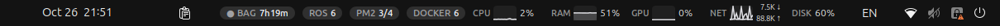
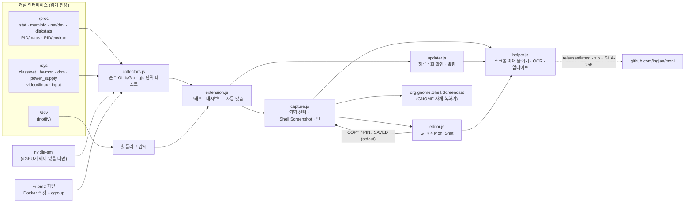

<div align="center">

[English](README.en.md) · **한국어**

# Moni

**로봇을 만드는 사람을 위한 상단바 시스템 모니터.**

CPU · RAM · GPU · 네트워크 · 디스크 · IP에 더해 ROS 2 프로세스, rosbag 디스크 잔여 시간, CAN 버스, PM2 앱, Docker 컨테이너, 센서 핫플러그까지.
스크롤 캡처와 OCR을 갖춘 Shottr 스타일 스크린샷, 화면 녹화, 클립보드 기록도 모두 GNOME 패널 안에 있습니다.

[](#호환성)
[](#호환성)
[](#-로보틱스-모드)
[](#동작-원리)
[](LICENSE)



<sub>설정 → General → Style: <b>Color</b>(애플 시스템 색상, 위) 또는 <b>Monochrome</b>(회색만, 아래).</sub>

[GitHub](https://github.com/ingjae/moni) · [주요 기능](#-주요-기능) · [기능](#기능) · [설치](#설치) · [동작 원리](#동작-원리) · [설정](#설정)

</div>

---

## ✨ 주요 기능

<table>
<tr>
<td width="50%" valign="top">

### 🛰️ ROS 2에 참여하지 않고 ROS 2를 봅니다
모든 ROS 2 프로세스를 CPU, 메모리, `ROS_DOMAIN_ID`, 배포판, RMW와 함께 보여 주지만 **Moni 자신은 ROS
노드가 아닙니다**. 각 프로세스의 메모리 맵에서 `librcl.so`를 찾기 때문에 DDS 디스커버리 트래픽을 보내지
않고 `ros2 node list`에도 나타나지 않습니다. 도메인 두 개가 동시에 쓰이면 ⚠로 알려 줍니다.

</td>
<td width="50%" valign="top">

### 💾 rosbag이 디스크를 채우기 전에 경고합니다
`● BAG 14m`은 *지금 쓰기 속도라면 14분 뒤 디스크가 가득 찬다*는 뜻입니다. 10분 미만이면 배지가
빨개집니다. 속도는 bag 디렉터리가 디스크에서 실제로 커지는 양으로 재기 때문에 페이지 캐시에 밀려
늦게 반영되지 않습니다.

</td>
</tr>
<tr>
<td valign="top">

### 🔌 LiDAR가 USB에서 빠지면 바로 알려 줍니다
`ttyUSB*`, `ttyACM*`, 카메라, 게임패드를 inotify로 지켜보므로 변화가 생기기 전까지는 비용이 없습니다.
장치가 빠지면 `/dev/serial/by-id` 이름으로 어떤 장치인지 알림을 띄웁니다.

</td>
<td valign="top">

### 🚌 CAN 버스를 한눈에
`CAN 1.2k`는 `can*`, `vcan*`의 초당 프레임 수입니다. 컨트롤러가 캐리어를 잃으면(bus-off) 배지가
빨개집니다. 조용한 버스는 패널에 나오지 않고 드롭다운에만 표시됩니다.

</td>
</tr>
<tr>
<td valign="top">

### 📸 리눅스에서 Shottr 스타일 캡처
<kbd>Super</kbd>+<kbd>Shift</kbd>+<kbd>S</kbd>: 영역, 창, 직전 영역, **스크롤 페이지**를 픽셀 돋보기와 함께
잡습니다. 편집기에는 화살표와 자유곡선 펜부터 블러, 스마트 지우개, 스포트라이트, **픽셀 자**, 자르기까지
15가지 도구와 그라데이션 배경이 있습니다. 그린 것은 모두 다시 옮길 수 있습니다. OCR을 켜면 글자를
복사하고 QR 링크를 엽니다. 결과는 복사, 저장하거나 모든 창 위에 **고정(핀)** 할 수 있습니다.

</td>
<td valign="top">

### 🎥 권한 창 없는 화면 녹화
<kbd>Super</kbd>+<kbd>Shift</kbd>+<kbd>D</kbd>는 GNOME 자체 화면 녹화 서비스로 영역이나 전체 화면을
녹화합니다. 그래서 Wayland에서도 권한 대화상자가 뜨지 않습니다. 단축키를 다시 누를 때까지 패널에
빨간 `● REC 0:42` 타이머가 표시됩니다.

</td>
</tr>
<tr>
<td valign="top">

### 🧭 시계를 가리지 않습니다
패널이 붐비면 시계까지 남은 공간을 재서 덜 중요한 항목부터 숨깁니다. 녹화, rosbag, ROS, CAN, PM2,
Docker 같은 경고는 가장 마지막에 숨겨집니다. 숨겨진 항목도 드롭다운에는 그대로 있습니다.

</td>
<td valign="top">

### 🪶 있는 줄도 모를 만큼 가볍습니다
`/proc`과 `/sys`를 읽는 GJS 확장 하나뿐입니다. Python도, 데몬도, `ros2` / `pm2` / `docker` CLI 폴링도
없습니다. 한 번 샘플링에 **0.35 ms**, 전체로는 코어 하나의 약 0.1 %입니다. 잠든 노트북 dGPU는 `zZ`로
표시하고, 측정하려고 **깨우지 않습니다**.

</td>
</tr>
<tr>
<td valign="top">

### 📋 붙여넣기까지 해 주는 클립보드 기록
<kbd>Super</kbd>+<kbd>Shift</kbd>+<kbd>V</kbd>: 입력해서 찾고 Enter나 클릭을 하면 **원래 있던 창에 바로
붙여넣습니다**. 터미널에는 <kbd>Ctrl</kbd>+<kbd>Shift</kbd>+<kbd>V</kbd>를 알아서 보냅니다. 하루에 열 번
치는 `export ROS_DOMAIN_ID=…`는 ★로 남겨 두세요. 비밀번호 관리자에서 복사한 내용은 기록하지 않습니다.

</td>
<td valign="top">

### 💼 설정을 그대로 옮기세요
설정 → Backup에서 모든 스위치, 단축키, ★ 즐겨찾기를 읽기 쉬운 JSON 파일 하나로 내보냅니다. 로봇 PC에서
가져오기만 하면 끝입니다. 모르는 키나 타입이 틀린 값은 억지로 바꾸지 않고 건너뜁니다.

</td>
</tr>
<tr>
<td valign="top">

### 🐳 크래시를 알아채는 PM2·Docker
`PM2 3/4`와 `DOCKER 6`은 실행 중인 개수입니다. 크래시 루프, errored 앱, 재시작 중이거나 unhealthy인
컨테이너가 있으면 배지가 빨개지고 알림이 옵니다. `~/.pm2`, `/proc`, Docker 소켓, cgroup에서 읽으므로
두 CLI 모두 실행하지 않습니다.

</td>
<td valign="top">

### 🎨 컬러 또는 모노크롬
둥글고 차분한 제어 센터 스타일 타일입니다. **Color**는 애플 시스템 팔레트를 쓰고, **Monochrome**은
그래프·배지·점을 모두 회색으로 바꾸며 경고는 빨강 대신 흰색 반전으로 보여 줍니다. 설정에서 바로 바뀝니다.

</td>
</tr>
</table>

<p align="center">
  
  &nbsp;&nbsp;
  
</p>
<p align="center"><sub>Ubuntu 24.04 / GNOME 46 실제 캡처. 왼쪽: 로보틱스 타일까지 스크롤한 드롭다운(캡처 버튼은 맨 위에 고정). 오른쪽: Moni Shot 편집기. IP, 경로, 내부 컨테이너 이름은 블러 처리했습니다.</sub></p>

## 기능

### 기본

| | 상단바 | 드롭다운 |
|---|---|---|
| **CPU** | 그래프 + % | 기록 그래프, **코어별 히트 바**, 패키지 온도 |
| **메모리** | 그래프 + % | 사용량 / 전체, 스왑 |
| **GPU** | 그래프 + % | NVIDIA · AMD · **Jetson**: 사용률, VRAM, 온도, 전력. 잠든 dGPU → `zZ`, 깨우지 않음 |
| **네트워크** | ↓/↑ 그래프 + 속도 | 처리량, probe host 지연(TCP 연결), Wi-Fi 신호 |
| **IP** | 기본 경로 주소 | 모든 인터페이스(이더넷, Wi-Fi, Tailscale 등). **클릭하면 복사** |
| **저장소** | 루트 사용률 % | 읽기/쓰기 그래프, 실제 마운트별 남은 공간 |
| **배터리** | — | %, 충전 상태, 와트(노트북만) |

### 🤖 로보틱스 모드

모든 기능은 끌 수 있습니다. 배지는 **보여 줄 것이 있을 때만 나타나므로** 로봇이 돌지 않을 때 패널은
깔끔하게 유지됩니다.

| 배지 | 나타나는 때 | 드롭다운 |
|---|---|---|
| `ROS 7` | ROS 2 프로세스가 실행 중 | 프로세스 표(node / launch / bag / container / CLI)와 CPU·RSS, 도메인, 배포판, RMW, 도메인이 섞이면 ⚠ |
| `● BAG 14m` | `ros2 bag record` 실행 중 | 출력 디렉터리, 쓰기 속도, 기록한 크기, 남은 공간, **디스크가 찰 때까지 남은 시간** |
| `CAN 1.2k` | CAN 버스에 트래픽이나 오류가 있음 | 인터페이스별 상태, 초당 rx/tx 프레임, 오류, 가상/물리 |
| `PM2 2/3` | `~/.pm2`의 PM2 데몬에 앱이 있음 | online/stopped/errored, CPU, 메모리, 재시작 횟수, 가동 시간, 마지막 종료 코드. errored 앱이나 크래시 루프(5분 안에 3회 이상)면 빨개지고 알림. `pm2` CLI 폴링 없이 `~/.pm2` 파일과 `/proc`에서 읽음 |
| `DOCKER 3` | 컨테이너가 실행 중 | 실행/종료된 컨테이너와 CPU, 메모리, 상태. unhealthy, 재시작 중, 크래시 루프(5분 안에 3회 이상 재시작)면 빨개짐. 0이 아닌 종료, 재시작, 헬스체크 실패 시 알림. 3초마다 Docker Engine 소켓 요청 1회와 컨테이너 cgroup 파일만 읽음 — `docker` CLI 없음 |
| — | 센서를 꽂거나 뺌 | `/dev/serial/by-id` 이름의 시리얼 장치, 카메라, 게임패드 + 알림 |

### 📸 캡처

| 단축키 | 동작 |
|---|---|
| <kbd>Super</kbd>+<kbd>Shift</kbd>+<kbd>S</kbd> | 스크린샷: 영역을 드래그(클릭 = 모니터 전체, Esc = 취소) → **Moni Shot** 편집기 |
| …이어서 <kbd>Space</kbd> | 창 모드: 캡처할 창을 클릭 |
| …이어서 <kbd>Enter</kbd> | 직전과 같은 영역 캡처 |
| …이어서 <kbd>S</kbd> | **스크롤 캡처**: 스크롤되는 부분을 드래그하면 Moni가 스크롤하며 긴 이미지 하나로 이어 붙임(고정 헤더는 한 번만) |
| …이어서 <kbd>T</kbd> | 글자 복사: 글자 위를 드래그 → OCR → 클립보드(OCR 옵션 필요) |
| …이어서 <kbd>3</kbd> / <kbd>5</kbd> | 타이머: 3초 또는 5초 뒤 화면 캡처 |
| <kbd>Super</kbd>+<kbd>Shift</kbd>+<kbd>D</kbd> | 화면 녹화 시작 / 중지 → `~/Videos/Screencasts/Moni_<time>.webm` |

두 기능 모두 드롭다운 맨 위에도 있고 설정에서 단축키를 바꿀 수 있습니다. 기본값이 <kbd>Ctrl</kbd>이 아니라
<kbd>Super</kbd>인 이유는 편집기, 브라우저, RViz의 *다른 이름으로 저장*을 빼앗지 않기 위해서입니다.
GNOME 기본 <kbd>Print</kbd> 도구는 건드리지 않습니다.

**Moni Shot 편집기 키**

| 키 | 도구 | | 키 | 도구 |
|---|---|---|---|---|
| <kbd>V</kbd> | 선택·이동: 드래그, 핸들로 크기 조절, <kbd>Del</kbd> 삭제, 화살표로 미세 이동 | | <kbd>B</kbd> | 모자이크 |
| <kbd>A</kbd> | 화살표 | | <kbd>G</kbd> | 블러 |
| <kbd>L</kbd> | 직선 | | <kbd>E</kbd> | 스마트 지우개(주변 색으로 채움) |
| <kbd>R</kbd> | 사각형 | | <kbd>S</kbd> | 스포트라이트(나머지를 어둡게) |
| <kbd>O</kbd> | 타원 | | <kbd>M</kbd> | 자(px, dx × dy) |
| <kbd>P</kbd> | 펜(자유곡선) | | <kbd>I</kbd> | 색 추출(hex 복사) |
| <kbd>H</kbd> | 형광펜 | | <kbd>C</kbd> | 자르기 |
| <kbd>T</kbd> | 텍스트(더블클릭으로 수정) | | <kbd>N</kbd> | 번호 단계 |

| 키 | 동작 | | 키 | 동작 |
|---|---|---|---|---|
| <kbd>1</kbd>–<kbd>8</kbd> | 색 | | <kbd>Ctrl</kbd>+<kbd>C</kbd> | 복사(편집기를 닫아도 클립보드에 남음) |
| <kbd>[</kbd> <kbd>]</kbd> | 선 굵기 | | <kbd>Ctrl</kbd>+<kbd>S</kbd> | 저장 → `~/Pictures/Screenshots/Moni_<time>.png` |
| <kbd>F</kbd> | 채운 도형 / 말풍선 텍스트 | | <kbd>Ctrl</kbd>+<kbd>P</kbd> | 모든 창 위에 **고정**: 드래그로 이동, 스크롤로 확대, 우클릭으로 닫기 |
| <kbd>Shift</kbd>+드래그 | 45° 선, 정사각형, 원 | | <kbd>Ctrl</kbd>+<kbd>Z</kbd> / <kbd>Ctrl</kbd>+<kbd>Shift</kbd>+<kbd>Z</kbd> | 실행 취소 / 다시 실행 |
| <kbd>Ctrl</kbd>+스크롤 | 확대(<kbd>Ctrl</kbd>+<kbd>0</kbd> 맞춤, <kbd>Ctrl</kbd>+<kbd>1</kbd> 100 %) | | <kbd>Space</kbd>+드래그 | 화면 이동 |
| <kbd>Esc</kbd> | 선택 해제, 한 번 더 누르면 닫기 | | | |

색, 굵기, 채우기는 선택한 주석에도 적용됩니다. 하단 바에는 커서의 이미지 픽셀 좌표와 그 아래 색이 표시되고,
배경(그라데이션, 둥근 모서리, 그림자), OCR, 고정, 저장 버튼이 있습니다.

**OCR과 QR 코드**는 기본으로 꺼져 있습니다. *설정 → Screenshot & recording → Text recognition*을 켜면
데스크톱 비밀번호 확인을 거쳐 apt로 `tesseract-ocr`(영어 + 한국어)와 `zbar-tools`를 설치합니다. 그러면
선택 화면에서 <kbd>T</kbd>로 글자를 복사할 수 있고, 편집기에 OCR 버튼이 생기며, 캡처한 QR 코드는 *Open*과
*Copy* 버튼이 있는 바로 표시됩니다. 인식은 로컬에서 실행됩니다.

### 📋 클립보드 기록

| | |
|---|---|
| 열기 | <kbd>Super</kbd>+<kbd>Shift</kbd>+<kbd>V</kbd> 또는 패널의 📋 아이콘(<kbd>Super</kbd>+<kbd>V</kbd>는 GNOME 알림 목록 그대로) |
| 찾기 | 그냥 입력하면 목록이 바로 걸러집니다 |
| 붙여넣기 | <kbd>Enter</kbd>(첫 결과) 또는 클릭. Moni가 텍스트를 클립보드에 되돌리고 원래 창에 <kbd>Ctrl</kbd>+<kbd>V</kbd>(터미널은 <kbd>Ctrl</kbd>+<kbd>Shift</kbd>+<kbd>V</kbd>)를 보냅니다 |
| 보관 | ★로 항목을 맨 위에 고정. 즐겨찾기는 저장되고, 최근 항목은 로그아웃 전까지 메모리에만 있습니다 |
| 개인정보 | 비밀번호 관리자가 표시한 복사(`x-kde-passwordManagerHint`)는 건너뜁니다. 텍스트만, 항목당 최대 100 KB |

자동 붙여넣기 없이 클립보드에 다시 복사만 하고 싶다면 설정에서 *Paste on pick*을 끄세요.

### ⚡ 빠른 복사

GitHub 토큰, 로봇 IP, 긴 명령어처럼 자주 복사하는 텍스트를 상단바 버튼 한 번으로 복사합니다.
설정 → Quick copy → *Add item*에서 아이콘(`GH` 같은 짧은 글자, 이모지 선택, 또는 직접 고른 PNG·SVG·JPG 이미지 — `~/.local/share/moni/quick-icons/`에 복사됨)과 복사할 텍스트를 정하세요.
누르면 버튼이 잠깐 ✓로 바뀌고, *On click* 설정에 따라 **복사 후 커서 위치에 붙여넣기**(기본), 복사만, 붙여넣기만(이후 원래 클립보드로 되돌림) 중 하나를 수행합니다. 텍스트 자체는 패널에 보이지 않고, 클립보드 기록에도 남지 않습니다.
텍스트는 ★ 즐겨찾기처럼 dconf에 평문으로 저장되며 *Export*에도 포함됩니다.

## 설치

```bash
git clone https://github.com/ingjae/moni.git && cd moni
make install                 # GNOME 42–44용 또는 45+용 빌드를 자동으로 고릅니다
```

GNOME Shell을 재시작한 뒤(**X11:** <kbd>Alt</kbd>+<kbd>F2</kbd> → `r` · **Wayland:** 로그아웃 후 다시 로그인):

```bash
gnome-extensions enable moni@ingjae.github.io
```

zip이 편하다면 [Releases](https://github.com/ingjae/moni/releases)에서 받으세요:

```bash
gnome-extensions install --force moni@ingjae.github.io.gnome45-48.v0.0.10.zip   # Ubuntu 24.04
gnome-extensions install --force moni@ingjae.github.io.gnome42-44.v0.0.10.zip   # Ubuntu 22.04
```

### 업데이트

**지금 버전 확인:** 설정 → About → *Version*, 또는:

```bash
gnome-extensions info moni@ingjae.github.io | grep Version
```

**자동 (v0.0.7 이상).** 하루 1회 GitHub에서 최신 릴리즈를 확인합니다. 새 버전이 있으면 알림에 **Update**
버튼이 뜨고, 적용할 때까지 드롭다운에 *Update to Moni x.y.z* 항목이 남습니다. Moni는 GNOME 버전에 맞는
zip을 받아 GitHub가 공개한 SHA-256 해시와 대조한 뒤 설치합니다. 설정 → Updates에서 하루 1회 확인을 끄거나,
묻지 않고 자동 설치하도록 바꿀 수 있습니다.

**지금 바로 확인 (v0.0.9 이상).** 설정 → Updates → **Check now**. 새 버전이 있으면 버튼이 **Update**로
바뀝니다.

**수동** (v0.0.6 이하이거나 업데이트 확인을 꺼 둔 경우), 클론한 저장소에서:

```bash
cd moni && git pull && make install
```

또는 [Releases](https://github.com/ingjae/moni/releases)에서 zip을 받습니다. 설치 전에 릴리즈 페이지의
파일 옆에 표시된 SHA-256 해시와 비교하세요:

```bash
sha256sum moni@ingjae.github.io.gnome45-48.v0.0.10.zip
gnome-extensions install --force moni@ingjae.github.io.gnome45-48.v0.0.10.zip
```

어떤 방법이든 셸을 재시작해야 적용됩니다. **X11:** <kbd>Alt</kbd>+<kbd>F2</kbd> → `r`(알림의
*Restart now* 버튼도 같으며 창은 그대로 유지됩니다) · **Wayland:** 로그아웃 후 다시 로그인.

빌드에 필요한 것: `python3`, `glib-compile-schemas`. 실행에 필요한 것: Ubuntu GNOME에 기본으로 있는 것뿐입니다
(`gjs`, GTK 4, libadwaita). `nvidia-smi`는 있으면 사용합니다. 선택 기능인 OCR / QR은 `tesseract-ocr`와
`zbar-tools`가 필요하며, 설정에서 켤 때 설치됩니다.

## 동작 원리



**ROS 레이더.** 환경 변수에 `ROS_DISTRO`가 있고 **동시에** `/proc/<pid>/maps`에 `librcl.so`가 매핑된
프로세스를 ROS 2 참여자로 봅니다. rclcpp, rclpy, rclrs가 모두 해당합니다. 결과는 PID별로 캐시하므로,
두 번째 스캔부터는 ROS 프로세스의 `/proc/<pid>/stat`만 다시 읽습니다. 막 시작해서 아직 `librcl`이 없는
프로세스는 rclpy를 불러올 시간으로 20초를 기다린 뒤 판정합니다.

**캡처.** 영역 선택과 픽셀 캡처는 셸 안에서 돌고, 편집기는 별도 GTK 4 프로세스입니다. 클립보드나 고정
이미지처럼 편집기보다 오래 살아야 하는 것은 stdout으로 셸에 넘깁니다. 그래서 편집기를 닫아도 복사한 내용이
남습니다. 녹화는 GNOME 자체 화면 녹화 서비스를 거치는데, 이 서비스는 셸의 버스 연결에서 온 호출만 받고
확장은 바로 그 안에서 돕니다. 스크롤 캡처는 셸에서 가상 마우스 휠을 굴리며 단계마다 한 장씩 찍고, 줄 맞춤과
이어 붙이기는 별도 프로세스인 `helper.js`에 맡겨 컴포지터가 멈추지 않게 합니다.

**성능**, i7-14700T(28 스레드)에서 `make test`로 측정:

| 작업 | 비용 | 주기 |
|---|---|---|
| 기본 틱(CPU, 메모리, 네트워크, 디스크 I/O, CAN, 온도) | **0.35 ms** | 1.5초마다 |
| ROS 레이더 스캔(캐시 있음, 약 500 프로세스) | **2.5 ms** | 3초마다 |
| ROS 레이더 첫 스캔(캐시 없음) | 33 ms | 1회 |
| PM2 스캔(`~/.pm2` + `/proc`) | 약 1 ms | 3초마다 |
| Docker 폴링(소켓 + cgroup) | 약 11–15 ms, 비동기 | 3초마다 |
| `ip`, 지연 측정 | 비동기 서브프로세스 / 소켓 | 10초마다 |

드롭다운 내용은 열려 있을 때만 계산합니다.

## 설정

드롭다운 맨 아래 **Settings**를 누르거나 `gnome-extensions prefs moni@ingjae.github.io`를 실행하세요.
모든 값은 `org.gnome.shell.extensions.moni`에 있어서 스크립트로도 바꿀 수 있습니다:

```bash
gsettings --schemadir ~/.local/share/gnome-shell/extensions/moni@ingjae.github.io/schemas \
  set org.gnome.shell.extensions.moni show-ip false
```

| 키 | 기본값 | |
|---|---|---|
| `update-interval` | `1500` | 샘플링 간격(ms) |
| `panel-position` | `right` | `left` / `center` / `right` |
| `style` | `color` | `color`(애플 시스템 색상) / `mono`(회색만, 경고는 빨강 대신 반전) |
| `graph-width` | `28` | 패널 그래프 너비(px) |
| `show-text` | `true` | 그래프 옆 숫자 |
| `show-cpu` `show-ram` `show-gpu` `show-net` `show-disk` `show-ip` | `true` | 패널 항목 |
| `show-ros` `show-rosbag` `show-can` `show-devices` | `true` | 로보틱스 모드 |
| `notify-devices` | `true` | 장치 연결 / 해제 알림 |
| `show-pm2` / `notify-pm2` | `true` / `true` | PM2 배지 + 카드 / 크래시·errored 알림 |
| `show-docker` / `notify-docker` | `true` / `true` | Docker 배지 + 카드 / 종료·재시작·unhealthy 알림 |
| `internet-probe` / `probe-host` | `true` / `1.1.1.1` | TCP 443 지연 측정 |
| `screenshot-shortcut` / `record-shortcut` | `<Super><Shift>s` / `<Super><Shift>d` | 캡처 단축키(비우면 끔) |
| `record-cursor` | `true` | 녹화에 마우스 포인터 표시 |
| `ocr` | `false` | OCR과 QR 코드(설정에서 켜면 tesseract와 zbar 설치) |
| `update-check` / `update-auto` | `true` / `false` | 하루 1회 릴리즈 확인 / 묻지 않고 설치 |
| `show-quick` / `quick-items` | `true` / `[]` | 빠른 복사 버튼 / 항목 JSON (`[{"icon": "GH", "image": "…", "text": "…"}]`) |
| `quick-action` | `both` | 클릭 동작: `both`(복사+붙여넣기) / `copy` / `paste` |
| `show-clipboard` / `clipboard-shortcut` | `true` / `<Super><Shift>v` | 클립보드 기록 아이콘 + 단축키 |
| `clipboard-paste` | `true` | 고르면 포커스된 창에 붙여넣기 |
| `clipboard-size` | `50` | 보관할 최근 항목 수(메모리에만) |
| `clipboard-favorites` | `[]` | ★ 항목 |

**백업.** 설정 → Backup → *Export…*는 위 값을 모두 `moni-settings.json`에 쓰고, *Import…*는 그 파일을
적용합니다(키마다 타입을 검사하고 모르는 키는 건너뜀). 셸에서는 `dconf dump /org/gnome/shell/extensions/moni/`도
쓸 수 있습니다.

패널이 붐비면 아래 순서의 뒤쪽부터 숨겨집니다:
`REC (screen) → BAG → ROS → CAN → PM2 → DOCKER → CPU → RAM → NET → GPU → DISK → IP`.

## 호환성

| | GNOME | 빌드 | 상태 |
|---|---|---|---|
| Ubuntu 24.04 | 46 | `esm` (45–48) | ✅ 테스트함 (X11 세션, 중첩 Wayland 셸) |
| Ubuntu 22.04 | 42 | `legacy` (42–44) | 🟡 같은 소스에서 생성. `make test`로 collector와 문법은 확인하지만 실제 42 세션에서는 아직 실행하지 않음 |
| Jetson (L4T, 22.04) | 42 | `legacy` | 🟡 GPU 사용률 경로는 지원, 실제 하드웨어에서는 미검증 |

ROS 2 감지는 배포판과 무관하며 Jazzy에서 테스트했습니다.

소스는 하나, 결과물은 둘입니다. `tools/build.py`가 ES 모듈 소스를 GNOME 42의 `imports.*` 형식으로 바꾸므로
두 빌드가 어긋날 일이 없습니다.

## 알려진 한계

- **다른 사용자나 root** 소유 프로세스(예: root Docker 컨테이너 안의 ROS 노드)는 권한 없이 들여다볼 수 없어
  레이더에 잡히지 않습니다.
- **Intel 내장 GPU** 사용률은 perf 카운터나 root가 필요해서 표시하지 않습니다.
- CAN **bus-off**는 캐리어 손실로 추정합니다. 정확한 컨트롤러 상태는 netlink가 필요합니다.
- **컴포넌트 컨테이너**는 담고 있는 노드 수와 상관없이 한 번만 나옵니다.
- PM2는 로그인한 사용자의 `~/.pm2`에서 읽습니다. root로 돌거나 `PM2_HOME`을 바꾼 PM2는 보이지 않습니다.
  재시작 횟수는 `pm2.log`에서 세므로 그 로그에 남아 있는 범위만 반영됩니다.
- Docker는 `/run/docker.sock` 읽기 권한(`docker` 그룹)이나 `$XDG_RUNTIME_DIR`의 rootless 소켓이 필요합니다.
  재시작 횟수는 Moni가 시작된 뒤부터 셉니다. Podman은 지원하지 않습니다.
- 자는 드래그한 길이를 잽니다. Shottr처럼 가장자리에 달라붙지는 않습니다.
- 스크롤 캡처는 마우스 휠 단위로 스크롤하고 줄을 정확히 맞춥니다. 애니메이션, 지연 로딩, 가로 스크롤이
  있는 페이지는 짧게 이어 붙을 수 있고, 40장에서 멈춥니다.
- OCR 품질은 tesseract 수준입니다. 깔끔한 UI 글자는 잘 읽지만 작거나 꾸민 글자는 덜 정확합니다.
- 업데이트는 디스크의 파일을 바꿉니다. 실행 중인 셸은 재시작 전까지 예전 코드를 씁니다.
  GNOME 42(libsoup 2.4) 다운로드 경로는 아직 실행해 보지 않았습니다.
- 클립보드 기록은 지금은 **텍스트만** 지원합니다. Moni Shot이나 다른 앱에서 복사한 이미지는 목록에 없습니다.

## 개발

```text
src/
  collectors.js   모든 데이터 수집 — GLib/Gio만 사용, 일반 gjs로 테스트 가능
  extension.js    패널 항목, 대시보드, 자동 맞춤, 단축키
  capture.js      영역 선택, 캡처, 핀, 녹화
  clipboard.js    클립보드 기록, 즐겨찾기, 붙여넣기
  quick.js        상단바 빠른 복사 버튼
  editor.js       Moni Shot 주석 편집기 (GTK 4, 별도 프로세스)
  updater.js      하루 1회 릴리즈 확인, 업데이트 알림, 재시작
  helper.js       스크롤 이어 붙이기, OCR, 릴리즈 다운로드 + SHA-256 확인 (별도 프로세스, 편집기도 import)
  prefs.js        libadwaita 1.1 호환 설정 창
tools/build.py    → build/esm, build/legacy, dist/*.zip
tests/            collector 스모크 테스트, 설정 백업 왕복, UI 회귀 테스트
```

```bash
make test      # collector, 스크롤 이어 붙이기, 업데이트 규칙, 설정 백업, UI 회귀 테스트 + legacy 빌드 로드/문법 검사
make test-ui   # GTK 편집기 렌더링 회귀 테스트 (그래픽 세션 필요)
make nested    # Moni를 올린 일회용 GNOME Shell을 창으로 실행
make logs      # moni로 걸러낸 gnome-shell 로그 따라가기
```

## 로드맵

- [ ] 고정한 토픽 몇 개의 토픽별 Hz (수동 DDS 리더, 옵트인)
- [ ] 여러 대 구성을 위한 `chrony` 시계 오차 배지
- [ ] ROS 표에 프로세스별 GPU 사용량
- [ ] Moni Shot 자의 가장자리 스냅
- [ ] GNOME 42 실기기 검증 후 extensions.gnome.org 등록

## 참고한 프로젝트와 감사

[Vitals], [TopHat], [system-monitor-next], [Astra Monitor]는 GNOME 패널 모니터가 얼마나 좋을 수 있는지
보여 주었습니다. [Shottr]는 스크린샷 도구가 어떤 느낌이어야 하는지 기준을 세웠습니다.

## 피드백

버그, 질문, 아이디어가 있으면 이슈를 열어 주세요:
**[github.com/ingjae/moni/issues](https://github.com/ingjae/moni/issues)**. 설정 → About → *Report an issue*로도
갈 수 있습니다. Ubuntu/GNOME 버전과 `make logs` 출력을 함께 적어 주시면 도움이 됩니다.

## 라이선스

[MIT](LICENSE)

[Vitals]: https://github.com/corecoding/Vitals
[TopHat]: https://github.com/fflewddur/tophat
[system-monitor-next]: https://github.com/mgalgs/gnome-shell-system-monitor-next-applet
[Astra Monitor]: https://github.com/AstraExt/astra-monitor
[Shottr]: https://shottr.cc
